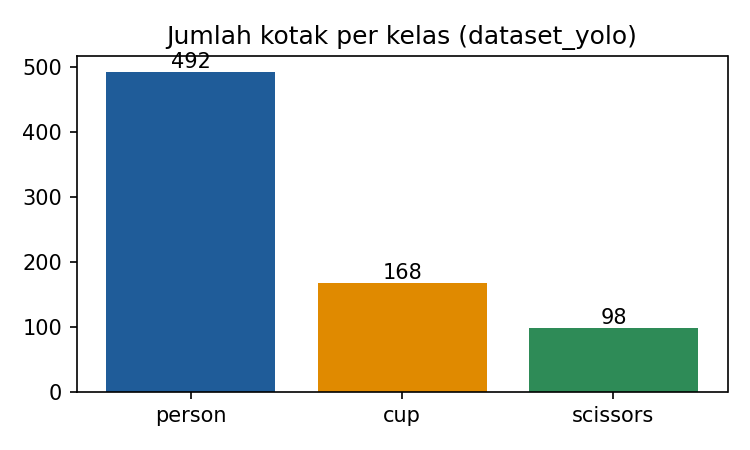
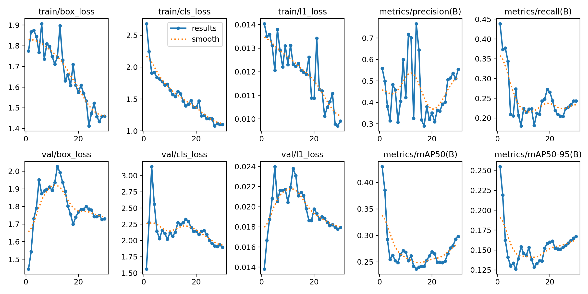
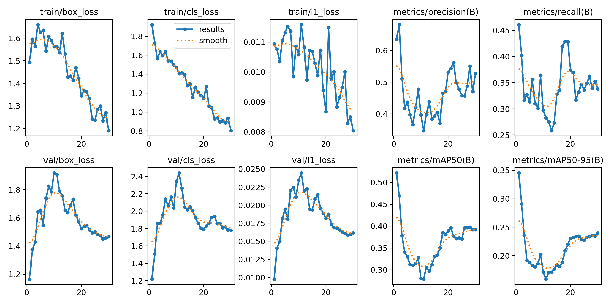

# Praktik Terpadu RET503: Dari COCO ke Detektor YOLO

- **NIM / Nama:** 4222401049 / Arya Yudha Sembiring
- **Mata kuliah:** RET503 Computer Vision and Deep Learning, Politeknik Negeri Batam
- **Kelas pilihan:** person, cup, scissors (subset COCO train2017)
- **Dataset:** `dataset_v1` (sidik jari label `6f9408b050`), seed = 49
- **Komputer:** Google Colab, GPU Tesla T4

## Isi repositori
| Folder | Isi | Asesmen |
|---|---|---|
| `1_data_projek/` | dataset subset COCO (train 3 bagian, val+test), `data.yaml`, grafik distribusi kelas | Tahap 1–2 (P3) |
| `2_hasil_eksperimen/` | hasil E1, E2, E3: `results.png`, `results.csv`, `args.yaml`, confusion matrix, kurva PR, `best.pt` (E1, E3) | Tahap 3 (P4) |
| `3_hasil_praktik/` | `hasil_praktik_4222401049.txt/.csv` dan salinan README | Tahap 4–6 (Pj1) |

Untuk memakai dataset: ekstrak keempat ZIP (`dataset_v1_train_bagian1.zip`, `bagian2`, `bagian3`, dan `dataset_v1_val_test.zip`) ke **satu folder yang sama** bernama `dataset_v1/` (isinya akan menyatu menjadi `images/` dan `labels/` dengan sub-folder train, val, test), lalu sesuaikan baris `path:` di `data.yaml` dengan lokasi folder tersebut. Dataset dipecah karena batas ukuran file pada upload GitHub lewat browser.

## Data
| Bagian | Gambar | Kotak person | Kotak cup | Kotak scissors |
|---|---|---|---|---|
| train | 140 | 343 | 135 | 61 |
| val | 40 | 86 | 22 | 27 |
| test | 20 | 63 | 11 | 10 |

Pembagian 70/20/10 setelah foto kembar dibuang. Kelas person mendominasi (±64% kotak latih), sedangkan scissors hanya ±11%.

## Eksperimen
Ketiganya memakai data, epochs=30, batch=16, dan seed yang sama.

| Eksperimen | Model awal | Perubahan |
|---|---|---|
| E1_pretrained | `yolo26n.pt` (bobot COCO) | baseline, imgsz=416 |
| E2_scratch | `yolo26n.yaml` (bobot acak) | tanpa transfer learning |
| E3_tuning | `yolo26n.pt` | satu perubahan: imgsz=640 |

## Hasil (data val)
| Eksperimen | mAP50 | mAP50-95 | P | R | ms/gambar | menit | Epoch terbaik |
|---|---|---|---|---|---|---|---|
| E1_pretrained | 0.429 | 0.250 | 0.569 | 0.426 | 7.5 | 1.8 | 1 |
| E2_scratch | 0.004 | 0.001 | 0.682 | 0.004 | 4.2 | 1.4 | 17 |
| E3_tuning (imgsz=640) | 0.521 | 0.347 | 0.624 | 0.461 | 10.5 | 1.8 | 1 |

**Model terpilih:** E3_tuning (mAP50-95 val tertinggi).

## Hasil di data test (dipakai sekali)
| Model | mAP50 | mAP50-95 | P | R | ms/gambar |
|---|---|---|---|---|---|
| E3_tuning | 0.610 | 0.444 | 0.584 | 0.668 | 9.0 |

## Grafik pelatihan
**E1_pretrained**

**E3_tuning**

## Analisis

**Transfer learning (E1 vs E2).** E1 yang memakai bobot pretrained COCO mencapai mAP50-95 0,250, sedangkan E2 yang dilatih dari nol hanya 0,001 dengan recall 0,004. Model dari nol hampir tidak mendeteksi objek apa pun setelah 30 epoch karena hanya memiliki 140 gambar latih, sementara E1 sudah membawa pengetahuan tentang tepi, tekstur, dan bentuk dari COCO. Precision E2 yang tinggi (0,682) tidak bermakna karena hampir tidak ada tebakan yang dibuat. Hasil ini menunjukkan manfaat transfer learning pada dataset kecil.

**Tuning (E3 vs E1).** Menaikkan imgsz dari 416 menjadi 640 meningkatkan mAP50 dari 0,429 ke 0,521, mAP50-95 dari 0,250 ke 0,347, dan recall dari 0,426 ke 0,461, sehingga perubahan ini dipertahankan. Kenaikan ini masuk akal karena objek kecil seperti gunting dan cangkir lebih terlihat pada resolusi lebih besar. Harganya, waktu inferensi naik dari 7,5 ke 10,5 ms per gambar (sekitar 40% lebih lambat), sedangkan waktu latih hampir sama (±1,8 menit). Kecepatan ini perlu dibandingkan dengan anggaran latensi pada perangkat yang akan dipakai.

**Kurva pelatihan.** Pada E1 dan E3, mAP50-95 val tertinggi dicapai di epoch 1 (0,255 dan 0,345), lalu turun hingga sekitar epoch 7–11 dan naik kembali sebagian hingga epoch 30 (0,167 dan 0,240) tanpa melampaui nilai awal. Loss latih turun stabil, tetapi loss val di akhir lebih tinggi daripada di epoch 1 (box loss E1 sekitar 1,44 menjadi 1,71; E3 sekitar 1,17 menjadi 1,46). Karena `best.pt` dipilih dari mAP50-95 val tertinggi, model yang dilaporkan sebenarnya adalah model epoch awal. Dugaan penyebabnya: pelatihan lanjutan pada data sekecil ini (±9 langkah per epoch) menggeser bobot pretrained dari kondisi awal yang sudah baik, dan data val yang kecil membuat metrik naik-turun tajam. Dugaan ini belum diuji dengan eksperimen, misalnya dengan learning rate lebih kecil atau epoch lebih banyak. Perbandingan E3 > E1 tetap konsisten di epoch 1 (0,345 vs 0,255) maupun epoch 30 (0,240 vs 0,167).

**Hasil per kelas (E3_tuning).** Kelas terkuat adalah *person* (mAP50-95 0,503; 343 kotak latih) dan terlemah *scissors* (0,142; 61 kotak latih), sehingga kelas dengan data paling sedikit memang paling sulit dikenali. Pada confusion matrix ternormalisasi, person terdeteksi benar 0,99, cup 0,95, dan scissors 0,78. Tertukar antar-kelas jarang (hanya 11% scissors yang diprediksi sebagai cup, dan 11% scissors terlewat sebagai latar). Kelemahan utama justru tebakan palsu pada latar: dari semua kotak tanpa objek sebenarnya, 48% diprediksi person, 37% cup, dan 15% scissors. Nilai diagonal lebih tinggi daripada recall pada tabel (0,461) karena dihitung pada ambang keyakinan dan IoU yang berbeda.

**Hasil test.** E3 memperoleh mAP50 0,610, mAP50-95 0,444, precision 0,584, dan recall 0,668. Nilai test lebih tinggi daripada val (0,347), tetapi data test hanya 20 gambar dengan 11 kotak cup dan 10 kotak scissors, sehingga angkanya sensitif terhadap gambar yang kebetulan masuk dan tidak boleh dibaca sebagai bukti bahwa model lebih baik pada data baru.

**Keterbatasan.** Dataset hanya 200 gambar dari 3 kelas, dengan satu seed dan satu kali percobaan per eksperimen, sehingga selisih kecil antar-eksperimen belum tentu bermakna. Kelas tidak seimbang (person dominan), data val dan test sangat kecil, dan model terbaik berasal dari epoch awal sehingga pengaturan pelatihan (learning rate, jumlah epoch) belum dioptimalkan.

**Saran lanjutan.** Menambah data kelas scissors, mencoba learning rate lebih kecil atau epoch lebih banyak dengan `patience`, dan mengulang dengan beberapa seed untuk melihat variasi hasil.
